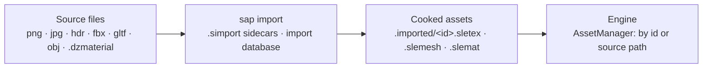

# SAssetPipeline

The asset pipeline of [SnowLeopardEngine](https://github.com/SnowLeopardEngine/SnowLeopardEngine): source files
(images, models, materials) are imported once into cooked assets in the exact layout the engine uses, so loading a game
is a read and an upload instead of decoding PNGs, running Assimp and parsing JSON at startup. The design follows
[vasset](https://github.com/zzxzzk115/vasset).



## How it works

- **Sidecars.** Every importable file gets `<file>.simport` next to it on first import: its stable id, the importer and
  the importer's parameters. Commit them with the sources: ids survive renames (the sidecar moves with the file), and a
  copied file whose sidecar came along gets a new id.

  ```ini
  [import]
  version=1
  importer=texture
  id=4a9da2a5-5de9-434f-b7d8-4bc75dda7d8f

  [params]
  compression=bc7
  maxSize=0
  mips=true
  quality=0
  srgb=true
  ```

- **Incremental.** `.imported/import-db.json` records what each cooked asset was made from (content hash, parameter
  hash, importer version). A source is re-imported only when one of them changes; an unchanged asset root imports in a
  fraction of a second.
- **Registry.** `.imported/registry.json` maps ids to sources, cooked files and dependencies (a material's textures).
  The engine looks assets up by id, or by source path (`Textures/X.png`, or `Assets/Textures/X.png` as the engine's
  scenes write it).
- **Cooked files.** One binary file per asset: a header (magic, versions, type, id) and a zstd-compressed payload.
  Readers validate sizes and versions; a stale or corrupt file is rejected, not misread.
- **Removal.** Assets whose source is gone are dropped from the registry and the cooked folder.

## Importers

| Importer | Sources | Cooked |
|---|---|---|
| texture | png, jpg, jpeg, tga, bmp | BC7 (or RGBA8), full mip chain filtered on linear values (sRGB colour is decoded first), rows top to bottom |
| texture | hdr | RGBA16F, one level |
| mesh | obj, fbx, gltf, glb, dae (Assimp) | 32-byte vertices (position, normal, uv) as the engine's `MeshVertexData`, node transforms baked, sub-meshes with bounds and material slots |
| material | .dzmaterial | properties, with texture paths resolved to texture ids (dependencies) |

Texture parameters: `srgb` (inferred from the file name: `rough`, `metal`, `normal`, `ao`, `mask`, `noise`... are
linear), `mips`, `compression` (`bc7` or `none`), `quality` (BC7 effort 0..4), `maxSize` (0: source size). BC7 needs
the top level to be a multiple of 4 texels; other sizes stay RGBA8. Textures with alpha get alpha weighted like colour
and a higher encoder effort, so cut-out edges (foliage) do not erode.

Mesh parameters: `scale`, `flipUVs` (v = 0 at the top: the engine stores textures top row first), `smoothNormals`,
`bakeTransforms`. Skinned meshes are imported in bind pose for now; skeletons and animations (ozz, built from the same
Assimp data) are next.

## Command line

```
sap import <asset root> [--force] [--quiet]
sap list <asset root>
sap info <cooked file>
```

The engine runs `sap import Assets` as a build step (incremental) before its apps.

## Layout

| Target | |
|---|---|
| `SAssetPipeline` | runtime: cooked formats, readers / writers, registry (nlohmann_json, zstd) |
| `SAssetPipelineImport` | importers, sidecars, import database (Assimp, stb, xxHash, vendored bc7enc) |
| `sap` | the command line tool |
| `SAssetPipelineTests` | builds an asset root in a temporary folder and checks imports, formats, incremental re-import, removal, corrupt files |

## Build

```bash
xmake f -m release
xmake
xmake build SAssetPipelineTests && xmake run SAssetPipelineTests
```

On Windows from a POSIX shell (Git Bash), pass `-p windows` to `xmake f`, or xmake picks MinGW.

The engine builds SAssetPipeline from a checkout while both are developed (`xmake f --sap_dir=../SAssetPipeline` in the
engine), and otherwise uses the `sassetpipeline` package.

## Third-party

- [bc7enc](https://github.com/richgel999/bc7enc_rdo) (MIT / public domain), vendored in `ThirdParty/bc7enc`
- Assimp, stb, xxHash, zstd, nlohmann/json (xmake packages)

## License

[MIT](LICENSE)
